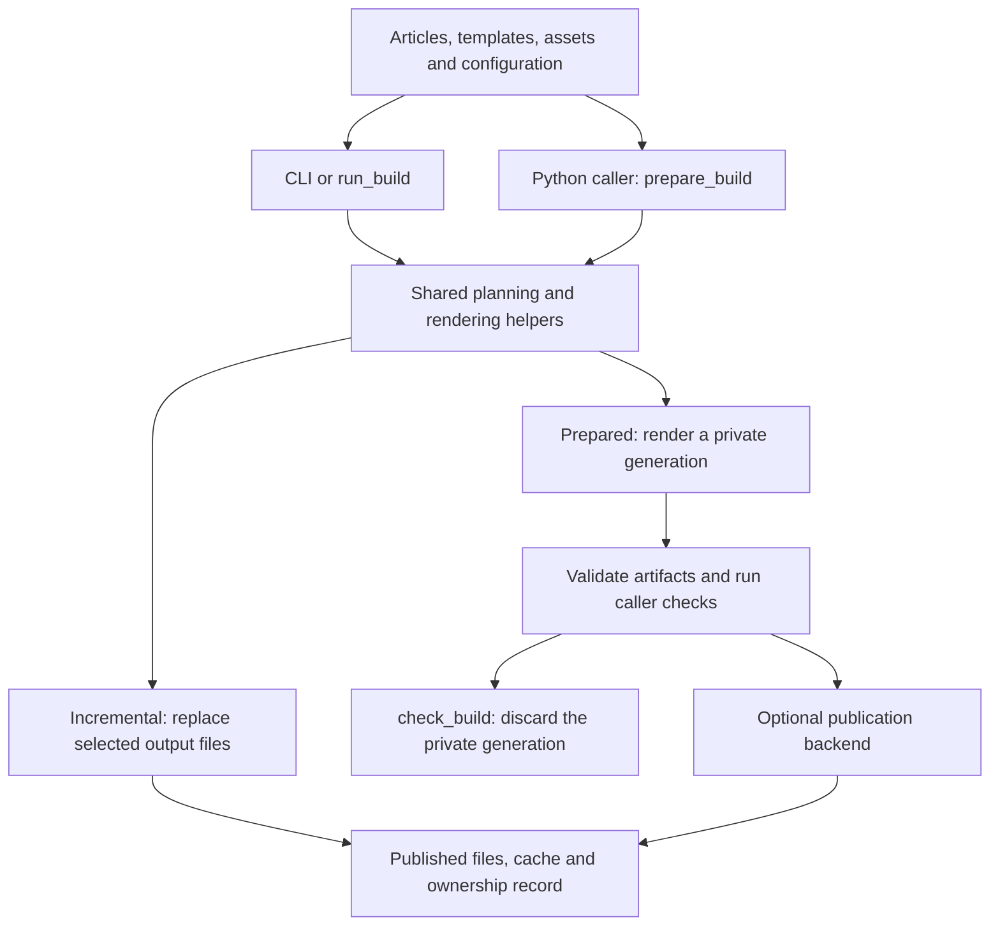

# Architecture

[Documentation](../README.md#documentation)

Articulous is a Python library and command-line application that turns local
article XML, XSLT templates and assets into a static website. Site content,
appearance and deployment policy belong to the caller. Articulous owns build
planning, rendering, generated-file ownership and optional local publication.

This guide describes the current implementation. Use
[getting started](getting-started.md) for setup and
[Python integration](generator-composition.md) for API examples.

## Build flow

Both build paths reuse the planner and rendering tasks in `pipeline.py`.
The diagram shows runtime flow; it is not a complete Python import graph.

### Incremental build

The installed `articulous` command, `python -m articulous` and
[`sitegen.py`](../sitegen.py) enter [`cli.py`](../articulous/cli.py).
The CLI parses options into a `BuildRequest`, loads configuration, applies path
checks and overrides, sets logging, checks dependencies and invokes `run_build`.

[`pipeline.run_build`](../articulous/pipeline.py) coordinates this workflow:

1. Normalize configuration and construct the private `BuildCtx` implementation.
2. Lock the output and cache, then load their cache and durable ownership state.
3. Discover articles, capture their inputs and build the required projections.
4. Plan routes and tasks; reject collisions and unsafe route migrations.
5. Record pending ownership, prepare output paths and mirror assets.
6. Run selected tasks, prune obsolete owned output and finalize cache/ownership.
7. Close task queues, article stores and temporary workspaces.

Fingerprints let unchanged outputs skip rendering. Individual output files are
replaced atomically; the complete incremental build can be partly updated after
a failure. Filters select work while shared listings and feeds retain their
documented scope. See [building and recovery](building.md).

### Prepared build and publication

[`builds.py`](../articulous/builds.py) reuses the planner with private output and
captured inputs. Prepared builds require an unfiltered request and render a fresh
generation, even if the request has `dry_run=True` or cached output exists.

`prepare_build` acquires locks and captures inputs. `render_prepared` executes
the plan once. `validate_generated` checks manifest targets and the staged-tree
fingerprint, then runs supplied validators. Theme-specific HTML/link checks are
opt-in. Revalidation revokes earlier validation handles before running checks.

`check_build` validates and discards its private generation. It preserves the
published files, cache and ownership record; lock files may remain after release.
[`publication.build_site`](../articulous/publication.py) instead selects a capable
backend, recovers any pending publication, prepares and validates the generation,
then publishes it. Its default Linux backend provides rollback and journal
recovery, with a brief visibility gap during directory replacement.

## Modules and responsibilities

| Area | Implementation and responsibility |
|------|-----------------------------------|
| Admission | [`config.py`](../articulous/config.py) loads/defaults/validates configuration and checks paths. [`sections.py`](../articulous/sections.py) defines shared section and URL-pattern policy. |
| Articles and publication policy | [`articles.py`](../articulous/articles.py) discovers and parses XML, captures source bytes and reports invalid records. [`article_contracts.py`](../articulous/article_contracts.py) defines publication state and eligibility. Scheduling uses one evaluation time for a build or capture. |
| Models and planning | [`models.py`](../articulous/models.py) builds page/feed models and URLs. [`pipeline.py`](../articulous/pipeline.py) coordinates projections, task creation, route collision checks and dispatch. |
| Rendering | [`engines.py`](../articulous/engines.py) implements lxml/Saxon adapters and stylesheet capture. [`sitemaps.py`](../articulous/sitemaps.py) serializes and partitions native sitemaps; pipeline native writers also produce search JSON and robots.txt. |
| Task execution and fingerprints | [`runtime.py`](../articulous/runtime.py) owns cache primitives, hashing, timing and the thread-pool workflow. Submission is limited to twice the worker count; failures cancel pending work and drain submitted tasks. |
| Route and capture adapters | [`composition.py`](../articulous/composition.py) stores route projections in SQLite. [`capture_adapter.py`](../articulous/capture_adapter.py) exposes captured articles through scoped readers. |
| Build lifecycle | [`builds.py`](../articulous/builds.py) owns prepared-generation state, validation revisions, private resources and read-only capability views. |
| Publication | [`publication.py`](../articulous/publication.py) selects capabilities and coordinates publication. [`publication_adapter.py`](../articulous/publication_adapter.py) projects private build state into backend input data. |
| Files and retained ownership | [`filesystem.py`](../articulous/filesystem.py) owns file/lock/staging primitives. [`ownership.py`](../articulous/ownership.py) stores durable output provenance and routes; [`migrations.py`](../articulous/migrations.py) plans owned route obstructions. |
| Native boundaries | [`backends/`](../articulous/backends/) contains publication, process, locking, image, HTTP-provider and XPath adapters. [`native_workspace.py`](../articulous/native_workspace.py) retains private native input copies through settlement or recovery. |

`pipeline.py` remains the main integration module: its concrete `BuildCtx`,
`BuildPlan`, article stores, serializers and task builders are implementation
details. Callers compose the library through the public contracts below.

## Contracts and adapters

A contract defines accepted data and operations. An adapter translates that
contract into concrete storage, XML, filesystem or process operations. Contract
modules define request/configuration shapes, value records and focused protocols
without requiring concrete planner, engine or storage classes.

| Contract | Role |
|----------|------|
| [`configuration_contracts.py`](../articulous/configuration_contracts.py) | Build requests, configuration schemas and engine-name admission. |
| [`composition_contracts.py`](../articulous/composition_contracts.py), [`extensions.py`](../articulous/extensions.py) | Routes, extra pages/artifacts, captured-site readers and composition callbacks. |
| [`transform_contracts.py`](../articulous/transform_contracts.py) | Structural engine interface, execution capabilities and ordinary transform failures. |
| [`build_contracts.py`](../articulous/build_contracts.py) | Prepared/staged/validated capabilities, artifact readers, validators, diagnostics and reports. |
| [`publication_contracts.py`](../articulous/publication_contracts.py) | Backend capabilities and the publication input boundary. |
| [`process_contracts.py`](../articulous/process_contracts.py), [`recovery_contracts.py`](../articulous/recovery_contracts.py), [`lock_contracts.py`](../articulous/lock_contracts.py) | Native-session operations, recovery identities and resource exclusion. |
| [`validation_contracts.py`](../articulous/validation_contracts.py) | Caller-supplied publication expectations and compact validation results. |

Implementations consume these abstractions. For example, the pipeline uses
`TransformEngine`; an external engine need not inherit `XsltEngine`. A composer
receives `CapturedSite` and route values rather than the private article store.
The publication adapter emits `PublicationInput` with serialized cache data,
read-only ownership/routes and a verification callback. The native publisher
receives that boundary data rather than `BuildCtx` or a task plan.

## Data and resource ownership

Article discovery feeds the requested projections in a shared scan. Full article
XML is spooled to disk for article rendering; shared listings keep metadata.
Sorting uses temporary chunks. Sitemap/search sinks are disk-backed, RSS keeps
a bounded newest-item heap (or one per language), and translation-link lookup
uses SQLite. These choices reduce repeated discovery and body retention; they
do not make every cost constant-memory. Tag groups, route inventories,
fingerprint maps and some model collections still grow with admitted content.

| Resource or state | Owner and lifetime |
|-------------------|--------------------|
| Article stores, model spools and task queues | The containing build/capture owns them until planning/rendering and submitted tasks settle; cleanup closes readers before removing their temporary files. |
| Route catalog cursors | The catalog owns admitted cursors. Iterator completion releases a cursor; catalog close settles remaining readers. Caller-created catalogs have a caller-owned context; prepared builds own their internal catalog. |
| Prepared generation | One private `_BuildState` owns lifecycle state. Public handles expose scoped views. Artifact readers settle before publication; closing the owner retires capabilities, and containing-context exit reclaims workspaces and locks. |
| Generated-output staging file | The filesystem adapter owns the original staging descriptor and verifies identity before atomic replacement. Callers borrow the writer within its scope. |
| Native Saxon session | The native adapter admits descriptor borrows; the session holds the leader's PID lease through group quiescence, diagnostic drainage and pipe closure. Uncertain cleanup retains the reservation and private inputs for recovery. |

The fingerprint cache is an optimization. The current ownership sidecar is the
durable source for retained files and route semantics; derived cache metadata
cannot override it. Partial sitemap builds include eligible retained extra pages
using that saved policy. Missing required route semantics force a full build.
The current plan's `OutputManifest` checks route collisions before writes.

Whole-site publication has a separate journal and backup lifecycle. Its reserved
transaction directory cannot overlap source/configuration or state paths.
Publication recovery and incremental ownership recovery are distinct workflows;
see [output and ownership](output.md) and [recovery actions](building.md#recover-after-a-failure).

## Optional components

These are library capabilities or explicitly selected tools; the standard build
does not automatically invoke every exported helper.

| Component | Boundary and use |
|-----------|------------------|
| Publication validation | [`site_validation.py`](../articulous/site_validation.py) checks local pages, links, redirects, search and sitemap data against `ValidationPlan`; callers wire it into their validation workflow. |
| Metadata catalogue | [`catalogue.py`](../articulous/catalogue.py) builds reusable publication metadata and tag-count projections, independently of theme XML and route-catalog storage. |
| Authoring and translation | Taxonomy/markup/translation contracts support explicit editing and provider workflows. [`translation_jobs.py`](../articulous/translation_jobs.py) coordinates jobs; [`translation_client.py`](../articulous/translation_client.py) handles retries/cache through provider/cache interfaces. [`translations.py`](../articulous/translations.py) separately serves build-time reciprocal links. |
| Source edits and images | [`source_transactions.py`](../articulous/source_transactions.py) stages file edits and attempts rollback after publication failure. [`image_optimization.py`](../articulous/image_optimization.py) uses an explicit image backend; normal asset mirroring does not optimize source images. |
| Theme resources and browser clients | [`theme_resources.py`](../articulous/theme_resources.py) returns immutable path/byte resources. Callers export and wire the optional code/search assets; they are not a default JavaScript dependency of the generator. |
| Local preview and metrics | [`preview.py`](../articulous/preview.py) serves a caller-selected tree on loopback. [`output_metrics.py`](../articulous/output_metrics.py) performs local size accounting. Neither deploys the site. |
| Verification tools | Coverage/complexity modules and packaged tooling assets support the documented acceptance workflows, independently of a site's normal build command. |

## Limits and extension points

Standard builds rely on the current Unix filesystem/locking layer. Supervised
Saxon execution and the implemented whole-site publisher require Linux. Their
Windows/macOS backends are unsupported. The publisher reports atomic whole-site
visibility and power-loss durability as unsupported; callers can require those
capabilities and receive rejection before staging.

Native supervision covers workloads that remain in the admitted session/group.
Retained recovery depends on eventual native stop evidence, successful resource
cleanup/storage and an owner or operator completing recovery. It does not prove
safe containment of detached workloads or unrestricted OS behavior.

Sites extend through composition callbacks, extra pages/artifacts, transform
engines, validators and publication/provider backends. Content vocabulary,
templates, hosted redirects and deployment remain site responsibilities. Use
[Python integration](generator-composition.md) for those contracts and lifetime
rules, [engines](engines.md) for rendering policy and
[development](development.md) for regression and measurement workflows.
